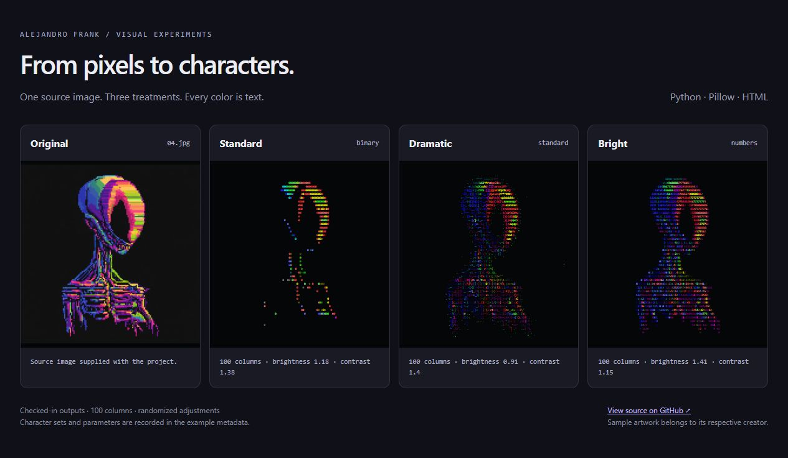

# ASCII art experiments

Turn images into colored, text-based artwork. A Python converter produces HTML with three visual treatments and several character sets.



**[Full-size comparison](docs/examples.png)** · **[Browse saved HTML outputs](visual/simpler/images/output)**

## What it does

- Converts every supported image in an input folder into **standard**, **dramatic**, and **bright** treatments.
- Chooses from ASCII, binary, numbers, letters, or a minimal `Xx` character set.
- Adjusts brightness, contrast, saturation, character columns, and display scale.
- Saves colored HTML plus JSON metadata recording the character set and processing parameters.

The examples above use the existing `04.jpg` sample and its checked-in outputs. That run used randomized adjustments, recorded in the sample metadata. Character sets are randomly selected for each treatment, so a fresh run can look different. The `--randomize` option additionally varies the image adjustments.

## Run it

Use Python 3.10 or newer with Pillow.

```bash
git clone https://github.com/alejandrofrank/art_exploring.git
cd art_exploring
python -m pip install -r requirements.txt
cd visual/simpler
python main.py
```

Put your own images in `visual/simpler/images/input/`. Open generated HTML from `visual/simpler/images/output/` in a browser. Processing metadata is saved to `visual/simpler/images/json/`.

```bash
# More character detail
python main.py --columns 300 --scale-factor 2

# Vary brightness, contrast, and saturation around each preset
python main.py --columns 150 --randomize

# Smaller output
python main.py --columns 50 --scale-factor 0.5
```

| Option | Default | Effect |
| --- | --- | --- |
| `--columns` | `150` | Character columns in the generated image |
| `--width-ratio` | `2.2` | Compensation for character proportions |
| `--scale-factor` | `1.0` | HTML character size and borders |
| `--randomize` | Off | Variation around each treatment's enhancement settings |

## How it works

Pillow resizes the source image to a character grid. Pixel brightness selects a character; color is matched against a fixed palette using HSV distance. The result is written as styled HTML, with a separate metadata file for each input image.

`main.py` handles batches and presets. `ascii_conversion.py` handles image processing, character selection, palette matching, and HTML output. Open `docs/gallery.html` locally to compare the checked-in examples; conversion runs in Python.

## Status and sample assets

An experimental art tool. The saved examples make it possible to inspect the results without installing dependencies.

Sample images are included for demonstration. I do not claim ownership of third-party source artwork; rights remain with the respective creators. Use images you own or have permission to transform when making your own work.
